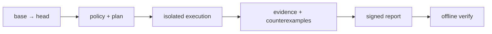

# PatchProof

<p align="center">
  <strong>English</strong> | <a href="docs/zh-CN/README.md">简体中文</a>
</p>

<p align="center">
  <a href="go.mod"></a>
  <a href="LICENSE"></a>
  <a href="https://github.com/rainyZhou2/PatchProof/actions/workflows/ci.yml"></a>
</p>

**Counterexample-first patch verification for Go repositories.**

PatchProof verifies a base→head change against a trusted policy, records the
evidence that was actually produced, and emits a signed report that can be
verified offline. A passing verdict means "the required claims met their stated
evidence levels within the recorded scope", not "the program is correct".



## Quick start

Requires Go 1.26+ and `git`.

```sh
git clone https://github.com/patchproof/patchproof.git
cd patchproof
make build

# Generate a policy in the repository under test.
bin/patchproof init --dir /path/to/repo

# Verify locally. Local mode only accepts trusted code.
bin/patchproof verify --repo /path/to/repo \
  --base HEAD~1 --head HEAD --policy /path/to/repo/patchproof.yaml
```

Review the generated policy (`contracts`, `execution.isolationTier`,
`protectedPaths`) before relying on it. For the full walkthrough, including
offline report verification, control-plane submission and Kubernetes, see
[Getting started](docs/getting-started.md).

## Why PatchProof

- **Counterexamples, not just failures.** Differential and fuzz violations
  carry a CAS-addressed input and observations that can be replayed;
  deterministic compile/test failures carry their logs and exit status.
- **Evidence you can audit.** Reports have a canonical Merkle manifest and an
  Ed25519 signature; verification does not need the control plane.
- **Correct under retries.** PostgreSQL is authoritative, dispatch is
  at-least-once, and generation fencing prevents stale workers from committing.
- **Boring infrastructure seams.** PostgreSQL, NATS, S3, Kubernetes and the
  executor are replaceable adapters behind ports.

## Features

| | |
|---|---|
| **Planning** | Policy-driven DAG with claims, contracts, budgets and protected paths. |
| **Execution** | Local, Kubernetes and remote cluster-agent executors; gVisor/VM isolation. |
| **Engines** | Go analyze, impact, compile, regression, differential fuzz, native fuzz. |
| **Extensibility** | In-process engines and out-of-process stdio plugins. |
| **Artifact IO** | Direct CAS access or brokered stage-in/execute/stage-out with no sandbox credentials. |
| **Result reuse** | Tenant-scoped action cache for declared hermetic analyze/impact/compile steps. |
| **Delivery** | Sharded scheduler, lease renewal, attempt fencing, transactional outbox. |
| **Reports** | JSON, Markdown and SARIF with offline integrity and policy verification. |

## How it works

1. Submit a repository reference, base/head commits, trusted policy and budget.
2. The control plane freezes snapshots, evaluates policy and plans a step DAG.
3. The scheduler leases ready steps and dispatches attempts to an executor.
4. Workers stage inputs, run engines, upload evidence and commit against the
   current generation.
5. The proof service validates evidence, computes the verdict, signs the report
   and serves it for offline verification.

Deep dives: [architecture](docs/architecture/overview.md) ·
[action cache](docs/architecture/action-cache.md) ·
[plugins](docs/architecture/plugins.md) ·
[brokered IO](docs/architecture/brokered-io.md) ·
[threat model](docs/security/threat-model.md).

## Documentation

| Start here | |
|---|---|
| [Getting started](docs/getting-started.md) | Build, local demo, control plane, Kubernetes. |
| [Verdicts and evidence levels](docs/concepts/verdicts.md) | What each result actually means. |
| [CLI reference](docs/reference/cli.md) | Commands, examples and exit codes. |
| [Configuration](docs/reference/configuration.md) | Environment variables, YAML, plugins, broker and cache. |
| [API guide](docs/api/README.md) | Public endpoints and conventions. |
| [Operations](docs/operations/README.md) | Signals, invariants and runbooks. |
| [Documentation index](docs/README.md) | All English docs. |
| [中文 README](docs/zh-CN/README.md) | 中文概览与文档入口。 |

## Development

```sh
make test        # hermetic unit tests
make test-race   # race detector
make bench       # benchmarks
make verify      # fmt, vet, tests, migration parity, asset checks
```

PostgreSQL integration tests are environment-gated:

```sh
PATCHPROOF_TEST_INTEGRATION=1 \
PATCHPROOF_TEST_POSTGRES_DSN='postgres://...' \
go test ./tests/integration/...
```

See [CONTRIBUTING.md](docs/CONTRIBUTING.md) and [tests/README.md](tests/README.md).

## Deployment

- [Helm chart](deploy/helm/patchproof): regional control plane, hardening,
  migrations, NetworkPolicies and ServiceMonitor.
- [Kustomize](deploy/kustomize): base and production overlay.
- [Compose](deploy/compose): integration stack; no execution cluster.
- [Staging](deploy/staging): acceptance values, policies and runner.

## Known limitations

- No SMT/formal proof engine and no Python/C++ engines are bundled.
- The bundled `go-security` scanner is a deterministic heuristic (TLS verify,
  shell construction, world-writable files, plaintext HTTP, committed private
  keys), not a full SAST or dependency CVE scanner.
- No exactly-once execution and no multi-region active-active; fencing and
  manual region procedures are the model.
- No OCI plugin auto-loader or generated gRPC client; plugins must be present in
  the worker image.
- Brokered mode requires a broker image, broker workload identity, a
  ReadWriteOnce volume and an enforced egress-deny policy. The Helm chart
  creates the execution-namespace default-deny and phase-specific allows.
- Live staging-cluster acceptance was not executed in this checkout. See the
  [staging runbook](docs/operations/runbooks/staging-verification.md).

## Security

Report vulnerabilities through [SECURITY.md](docs/SECURITY.md). Do not open a public
issue for a suspected vulnerability. `trusted-local` executes code in-process
and must never be used for untrusted pull requests.

## License

Apache-2.0. See [LICENSE](LICENSE) and
[third_party/licenses.csv](third_party/licenses.csv).
