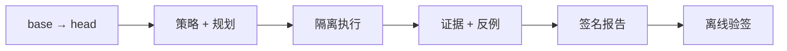

# PatchProof

<p align="center">
  <a href="../../README.md">English</a> | <strong>简体中文</strong>
</p>

<p align="center">
  <a href="../../go.mod"></a>
  <a href="../../LICENSE"></a>
  <a href="https://github.com/patchproof/patchproof/actions/workflows/ci.yml"></a>
</p>

**面向 Go 仓库的反例优先补丁验证平台。**

PatchProof 针对 base→head 变更执行可信策略，记录真实产生的证据，并生成可离线独立
验证的签名报告。通过结论表示“必需 claim 在记录范围内达到了声明的证据等级”，
而不是“程序正确”。



## 快速开始

需要 Go 1.26+ 和 `git`。

```sh
git clone https://github.com/patchproof/patchproof.git
cd patchproof
make build

# 在待验证仓库中生成策略模板
bin/patchproof init --dir /path/to/repo

# 本地验证；本地模式只适用于可信代码
bin/patchproof verify --repo /path/to/repo \
  --base HEAD~1 --head HEAD --policy /path/to/repo/patchproof.yaml
```

使用前请检查生成的策略（`contracts`、`execution.isolationTier`、`protectedPaths`）。
包含离线验签、控制面提交和 Kubernetes 的完整流程见
[快速开始](getting-started.md)。

## 为什么选择 PatchProof

- **反例优先，而不只是“失败”。** 被推翻的 claim 带有可在 CAS 中寻址、可重放的
  输入和观测结果。
- **证据可审计。** 报告包含规范化 Merkle manifest 与 Ed25519 签名，验证不依赖控制面。
- **重试下仍然正确。** PostgreSQL 是权威状态，分发是 at-least-once，generation
  fencing 阻止过期 Worker 提交结果。
- **基础设施可替换。** PostgreSQL、NATS、S3、Kubernetes 和执行器都是 port 后的 adapter。

## 特性

| | |
|---|---|
| **规划** | 策略驱动的 DAG，包含 claim、contract、预算和 protected paths。 |
| **执行** | 本地、Kubernetes、远程 cluster-agent；支持 gVisor/VM 隔离。 |
| **引擎** | Go analyze、impact、compile、regression、differential fuzz、native fuzz。 |
| **扩展** | 进程内引擎与进程外 stdio 插件。 |
| **产物 IO** | 直连 CAS，或 brokered stage-in/execute/stage-out，沙箱无凭据。 |
| **结果复用** | 租户隔离的 Action Cache，仅用于声明的 hermetic analyze/impact/compile。 |
| **调度** | 分片调度、租约续约、attempt fencing、事务 outbox。 |
| **报告** | JSON、Markdown、SARIF；支持离线完整性与策略验证。 |

## 工作方式

1. 提交仓库引用、base/head 提交、可信策略和预算。
2. 控制面冻结快照、评估策略并规划步骤 DAG。
3. Scheduler 租用 Ready 步骤，将 attempt 分发到执行器。
4. Worker 准备输入、运行引擎、上传证据，并针对当前 generation 提交结果。
5. Proof 服务校验证据、计算 verdict、签名报告并对外提供离线验证。

深入阅读：[架构总览](../architecture/overview.md) ·
[Action Cache](../architecture/action-cache.md) ·
[插件](../architecture/plugins.md) ·
[Brokered IO](../architecture/brokered-io.md) ·
[威胁模型](../security/threat-model.md)。

## 文档

| 从这里开始 | |
|---|---|
| [快速开始](getting-started.md) | 构建、本地演示、控制面、Kubernetes。 |
| [Verdict 与证据等级](concepts/verdicts.md) | 每个结果的确切含义。 |
| [CLI 参考](reference/cli.md) | 命令、示例与退出码。 |
| [配置参考](reference/configuration.md) | 环境变量、YAML、插件、broker、缓存。 |
| [API 指南](../api/README.md) | 公开端点与约定。 |
| [运维](../operations/README.md) | 指标、不变量与 runbook。 |
| [英文文档索引](../README.md) | 全部英文文档。 |
| [中文文档索引](index.md) | 中文文档入口。 |

## 开发

```sh
make test        # 无外部依赖的单元测试
make test-race   # race detector
make bench       # benchmark
make verify      # fmt、vet、测试、迁移一致性、资产检查
```

PostgreSQL 集成测试需要显式开启：

```sh
PATCHPROOF_TEST_INTEGRATION=1 \
PATCHPROOF_TEST_POSTGRES_DSN='postgres://...' \
go test ./tests/integration/...
```

参见 [CONTRIBUTING.md](../CONTRIBUTING.md) 与 [tests/README.md](../../tests/README.md)。

## 部署

- [Helm chart](../../deploy/helm/patchproof)：区域控制面、安全加固、迁移、
  NetworkPolicy 和 ServiceMonitor。
- [Kustomize](../../deploy/kustomize)：base 与 production overlay。
- [Compose](../../deploy/compose)：集成栈，不含执行集群。
- [Staging](../../deploy/staging)：验收 values、策略与 runner。

## 已知限制

- 未内置 SMT/形式化证明引擎，也未内置 Python/C++ 引擎。
- 不提供 exactly-once 执行，也不支持多区域 active-active；模型是 fencing + 人工区域流程。
- 没有 OCI 插件自动加载器或生成的 gRPC 客户端；插件必须存在于 Worker 镜像中。
- Brokered 模式需要 broker 镜像、broker workload identity、ReadWriteOnce 卷和强制
  egress-deny 策略。
- 本仓库环境未执行真实 staging 集群验收。参见
  [staging runbook](../operations/runbooks/staging-verification.md)。

## 安全

请通过 [SECURITY.md](../SECURITY.md) 报告漏洞，不要为疑似漏洞开公开 issue。
`trusted-local` 在进程内执行代码，绝不能用于不可信 PR。

## 许可证

Apache-2.0。参见 [LICENSE](../../LICENSE) 与
[third_party/licenses.csv](../../third_party/licenses.csv)。
